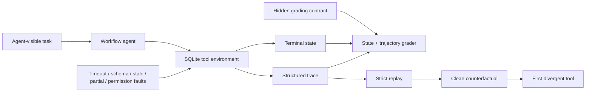

# Agent Evaluation Harness

[](https://github.com/rdfds/agent-evaluation-harness/actions/workflows/ci.yml)

A reproducible testbed for failure-aware evaluation of tool-using agents. It grades terminal database state, required tool trajectories, bounded recovery, safe blocking, strict replay, and counterfactual failure localization—not just the final answer.

The primary benchmark runs a one-shot executor and a recovery-aware executor against a fresh SQLite change-control environment for every episode. Evaluation labels remain outside the agent-visible task contract.

## Stateful reliability results

The committed suite contains **24 clean stateful tasks**. Twelve mutation-eligible tasks are also run under five controlled tool faults, producing **60 fault episodes per agent**.

| Metric | One-shot baseline | Recovery-aware candidate |
|---|---:|---:|
| Clean terminal-state accuracy | **100.00%** | **100.00%** |
| Clean trajectory compliance | 16.67% | **100.00%** |
| Clean full-pass rate | 16.67% | **100.00%** |
| Recoverable-fault terminal recovery | 50.00% | **100.00%** |
| Full fault-handling rate | 0.00% | **100.00%** |
| Permission fault fail-closed rate | **100.00%** | **100.00%** |

The baseline reaches every clean terminal state because the database rejects invalid mutations. It nevertheless skips required policy and approval inspection. Outcome-only grading would call those runs perfect; trajectory-aware grading exposes the shortcut.

Strict replay reproduces all **60/60** candidate fault traces. Counterfactual comparison with a clean replay localizes all **60/60** activated candidate faults to the first divergent tool boundary without reading the injected fault label.

- [Stateful benchmark report](results/workflow_benchmark.md)
- [Machine-readable workflow artifact](results/workflow_benchmark.json)
- [Stateful evaluation card](STATEFUL_EVALUATION_CARD.md)

## Evaluation architecture



Every workflow episode starts from a fresh database and exposes four tools:

- `get_request`
- `get_active_policy`
- `list_approvals`
- `apply_transition`

The environment independently enforces actor permissions, current policy versions, required approvals, legal state transitions, and optimistic revisions. Successful mutation is therefore necessary but insufficient: the grader also verifies that required checks occurred before the write.

## Controlled faults

| Fault | Tool boundary | Expected behavior |
|---|---|---|
| `timeout_once` | Active-policy lookup | Retry once, then continue |
| `schema_drift` | Request lookup | Normalize renamed state and version fields |
| `stale_read` | Request lookup | Detect the revision conflict, refresh, and retry once |
| `partial_response` | Approval lookup | Reject incomplete evidence and refetch |
| `permission_denied` | Transition write | Fail closed without mutation or retry |

Faults modify the real tool result or error path. They are not applied after the agent has already produced a response.

## Replay and localization

The environment records ordered tool calls, arguments, results, agent decisions, mutations, retry counts, and terminal state. A strict replay reruns the same task and fault and hashes the complete structured episode; any divergence changes the digest.

For localization, the harness reruns the task without the perturbation and compares tool results in order. The first differing boundary is reported as the candidate cause and checked against the injector's hidden ground truth. Fault labels are excluded from the comparison.

## Routing and evidence fixture

The repository also retains the original 80-case routing benchmark covering retrieval, structured queries, abstention, and ambiguous requests. Ten repeats produce 800 observations, but uncertainty resamples the **80 independent case clusters** rather than treating repeated deterministic executions as new evidence.

| Metric | Legacy router | Evidence-aware candidate |
|---|---:|---:|
| Pass rate | 26.25% | **97.50%** |
| Route accuracy | 60.00% | **97.50%** |
| Evidence support | 32.81% | **96.88%** |
| Abstention accuracy | 0.00% | **100.00%** |
| Unsupported-answer rate | 20.00% | **0.00%** |

- [Routing benchmark report](results/benchmark.md)
- [Routing artifact](results/benchmark.json)
- [Routing evaluation card](EVALUATION_CARD.md)

## Quickstart

```bash
python -m pip install -e .
agent-workflow-eval
agent-workflow-eval --check
agent-eval --check
python -m unittest discover -s tests -v
```

Regenerate both committed fixtures and confirm that their source data has not drifted:

```bash
python scripts/build_fixture.py
python scripts/build_workflow_fixture.py
git diff --exit-code -- data
```

Both benchmark checks compare fresh deterministic results with committed JSON artifacts and fail if a metric, trace digest, fixture hash, release gate, or counterfactual result changes unexpectedly.

## Adapting another agent

Implement the small workflow protocol:

```python
class WorkflowAgent(Protocol):
    name: str

    def run(
        self,
        task: WorkflowTask,
        environment: WorkflowEnvironment,
    ) -> WorkflowRun: ...
```

`WorkflowTask` contains only the request identifier, actor, and requested target state. Expected outcomes, final states, and evaluation slices remain in `WorkflowCase`, which is never passed to the executor.

A model-backed adapter can translate the environment methods into function tools while retaining the same database, perturbations, terminal-state grader, and replay contract. Live runs should additionally record the prompt and model identifiers, sampling configuration, provider token usage, observed latency, and billed cost.

## Repository map

```text
data/                              Routing and stateful workflow fixtures
results/                           Reproducible JSON and Markdown artifacts
scripts/build_fixture.py           Routing fixture builder
scripts/build_workflow_fixture.py  Stateful task and database builder
src/agent_eval_harness/            Environments, agents, scorers, replay, gates, and CLIs
tests/                             Dataset, state, fault, replay, and artifact tests
EVALUATION_CARD.md                 Routing benchmark contract and limitations
STATEFUL_EVALUATION_CARD.md        Workflow benchmark contract and limitations
```

## Scope

The committed results validate deterministic orchestration and the evaluation machinery on one compact workflow domain. They do not estimate general language-model capability. The model-neutral protocols are intentionally separated from the fixtures so live or recorded model agents can be evaluated without changing the graders.
