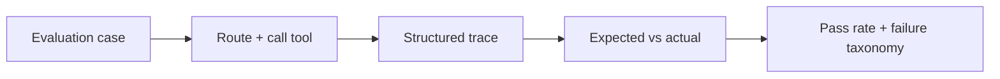

# Agent Evaluation Demo

A compact evaluation harness for a tool-using agent that chooses between retrieval and structured queries. Every run records a trace, compares the route and answer with a deterministic expected result, categorizes failures, and repeats the suite to expose variance.

The data and tools are synthetic. The point is to make evaluation behavior visible, not to claim production agent quality.

## What it demonstrates

- Explicit routing between retrieval and structured-query tools
- Trace records for route selection, tool invocation, and answer generation
- Deterministic test cases with expected route and answer
- Failure categories instead of one aggregate score
- Repeated-run statistics for detecting nondeterministic behavior

## Flow



## Run it

```bash
python -m src.agent_eval
python -m unittest discover -s tests -v
```

The demo prints a JSON report with repeated-run pass rate, route counts, and categorized failures.

## Repository layout

- `src/agent_eval.py` — synthetic tools, agent, trace schema, and evaluator
- `tests/test_agent_eval.py` — routing, trace, and failure-taxonomy tests
- `.github/workflows/ci.yml` — reproducible test check

## Evaluation notes

The harness treats a wrong tool choice as a distinct failure from a wrong answer. That distinction matters in production: a good answer from the wrong data path can still be unsafe, difficult to audit, or impossible to reproduce. The next extension would be to plug in real trace storage and a model adapter while keeping the same case and scoring contracts.
