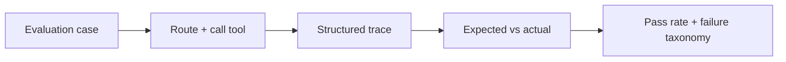

# Agent Evaluation Harness

[](https://github.com/rdfds/agent-evaluation-harness/actions/workflows/ci.yml)

A reproducible evaluation harness for a tool-using agent that chooses between retrieval and structured queries. Every run records a structured trace, compares the selected route and answer with an expected contract, categorizes failures, and repeats the suite to expose variance.

## Evaluation contract

- Explicit routing between retrieval and structured-query tools
- Trace records for route selection, tool invocation, and answer generation
- Deterministic test cases with expected route and answer
- Failure categories instead of one aggregate score
- Repeated-run statistics for detecting nondeterministic behavior

## Flow



## Run it

```bash
python -m src.agent_eval
python -m unittest discover -s tests -v
```

The harness prints a JSON report with repeated-run pass rate, route counts, categorized failures, and one complete trace per case. The committed baseline evaluates 5 cases across 5 repetitions. Four cases pass; one intentionally ambiguous request produces separate route and answer failures, yielding a repeatable `0.8` pass rate and making the failure taxonomy observable in CI.

## Repository layout

- `src/agent_eval.py` — deterministic retrieval/query tools, agent, trace schema, and evaluator
- `tests/test_agent_eval.py` — routing, trace, and failure-taxonomy tests
- `.github/workflows/ci.yml` — reproducible test check

## Evaluation notes

The harness treats a wrong tool choice as a distinct failure from a wrong answer. That distinction matters in production: a good answer from the wrong data path can still be unsafe, difficult to audit, or impossible to reproduce. Keeping cases, traces, routing decisions, and failure categories explicit makes the same contract usable when the deterministic baseline is replaced by a model-backed implementation.
