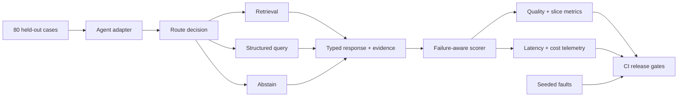

# Agent Evaluation Harness

[](https://github.com/rdfds/agent-evaluation-harness/actions/workflows/ci.yml)

A failure-aware evaluation system for tool-using agents. It separates routing, answer, evidence, abstention, latency, cost, and repeated-run reliability so a candidate cannot hide a serious regression behind one aggregate score.

The repository includes an 80-case public fixture, a legacy comparison policy, an evidence-aware candidate, typed traces, case-cluster bootstrap intervals, per-slice metrics, configurable release gates, and mutation tests that prove the gates fail when important behavior breaks.

## Results

The default benchmark evaluates **80 independent cases** across 10 repeated runs, producing 800 observations. Confidence intervals resample whole case clusters, so repeated executions are not misrepresented as independent evidence.

| Metric | Legacy router | Evidence-aware candidate |
|---|---:|---:|
| Pass rate | 26.25% | **97.50%** |
| Route accuracy | 60.00% | **97.50%** |
| Answer accuracy | 26.25% | **97.50%** |
| Evidence support | 32.81% | **96.88%** |
| Abstention accuracy | 0.00% | **100.00%** |
| Unsupported-answer rate | 20.00% | **0.00%** |

The candidate passes all seven release gates. Mutation testing detects **4/4 seeded regressions**: route swaps, stale answers, missing evidence, and disabled abstention.

- [Full benchmark report](results/benchmark.md)
- [Machine-readable artifact](results/benchmark.json)
- [Evaluation card](EVALUATION_CARD.md)

## What is evaluated



Each response carries:

- selected route and normalized answer
- evidence identifiers used to support the answer
- routing and tool trace events
- confidence, latency, and token/cost accounting

Each evaluation case declares its expected route, answer, required evidence, difficulty, and slice. The scorer records distinct `route_mismatch`, `answer_mismatch`, `missing_evidence`, and `unsupported_answer` failures.

## Dataset

The committed fixture covers:

| Slice | Cases | Purpose |
|---|---:|---|
| Retrieval | 32 | Policy, note, memo, and guidance lookup across paraphrases |
| Structured query | 24 | Counts, averages, filtered summaries, and alternate quantitative phrasing |
| Abstention | 16 | Missing, private, forward-looking, and instruction-conflict requests |
| Challenge | 8 | Mixed cues, hard paraphrases, and routing ambiguity |

The two retained hard failures are reported in the artifact and keep the public benchmark from presenting a false perfect score.

## Quickstart

```bash
python -m pip install -e .
python -m agent_eval_harness
python -m agent_eval_harness --check
python -m unittest discover -s tests -v
```

The first command writes `results/benchmark.json` and `results/benchmark.md`. The `--check` command re-runs the benchmark, compares deterministic fields with the committed artifact, enforces release thresholds, and verifies that every seeded regression is detected. Machine-dependent latency fields are intentionally excluded from golden equality checks.

Regenerate the fixture and confirm that it is committed without drift:

```bash
python scripts/build_fixture.py
git diff --exit-code -- data
```

## Release gates

The default candidate must satisfy all of the following:

- pass rate, route accuracy, and answer accuracy at or above 95%
- evidence-support and abstention accuracy at or above 95%
- unsupported-answer rate at or below 2%
- repeated-run pass-rate standard deviation at or below 0.001
- all seeded faults detected by at least one gate

Quality thresholds are intentionally evaluated separately. A route regression cannot be offset by a good answer, and an unsupported answer cannot be hidden by high aggregate accuracy.

## Use with a model-backed agent

Implement the small `Agent` protocol in `runtime.py`:

```python
class Agent(Protocol):
    name: str

    def answer(self, query: str) -> AgentResponse: ...
```

An adapter can call any model or orchestration stack as long as it returns an `AgentResponse` with a route, answer, evidence IDs, trace, usage, and latency. The evaluator and gates do not depend on a provider SDK.

## Repository map

```text
data/                         Committed cases and knowledge fixtures
results/                      Reproducible JSON and Markdown benchmark artifacts
scripts/build_fixture.py      Deterministic dataset builder
src/agent_eval_harness/       Agents, contracts, metrics, gates, faults, and CLI
tests/                        Dataset, trace, metric, gate, mutation, and artifact tests
EVALUATION_CARD.md            Scope, methods, limitations, and interpretation
```

## Interpretation

The public benchmark validates the harness and the included deterministic routing policies. It is designed so the same contracts can evaluate recorded or live model responses; it does not represent a hosted foundation-model benchmark. Reference cost is computed from configurable token rates, while observed latency is reported separately and allowed to vary by machine.
